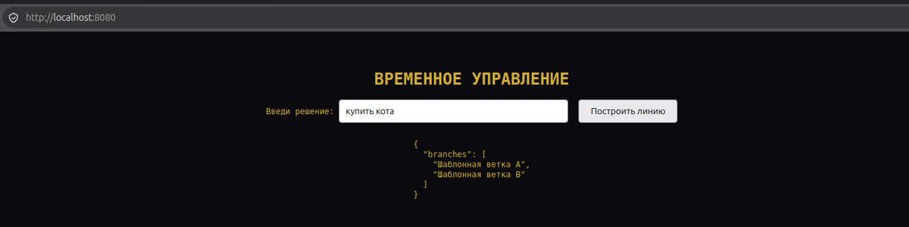

# timeline — карта временной линии



Учебный проект курса «AI-агенты». Веб-приложение для визуализации дерева последствий
при принятии решений (эстетика TVA из «Локи»): пользователь вводит решение, LLM генерирует
ветки-последствия (до 3 уровней), в конце — «карта временной линии».

Стек: Java 17 · Spring Boot 3.3.5 · Maven · PostgreSQL (позже) · Thymeleaf/HTMX ·
JUnit 5 · Checkstyle · Spotless. Агент разработки: OpenCode 1.19.0 (DeepSeek).

Полное описание проекта — `docs/project-description.md`.
Настройка AI-среды и скриншоты — `docs/about.md`.

## Как ориентироваться в репозитории

- `AGENTS.md` — инструкции для агента (стек, команды, конвенции, запреты).
- `src/main/java/ru/janeforjane/timeline/llm/AGENTS.md` — правило, действующее только на модуль `llm/`.
- `.opencode/` — скилл `write-tests`, команда `/wrong-branch`, плагин-hooks `project-guard.ts`,
  конфиг прав `opencode.json`.
- `docs/plan.md` + `docs/memory.md` — память агента между сессиями (handoff).
- `docs/about.md` — подробно о настройке среды + скриншоты.

## Запуск

```bash
mvn spring-boot:run    # http://localhost:8080
```

## Текущее состояние (модуль 2 — GSD)

В проект внедрён GSD-пайплайн (Git. Ship. Done): фазы Discuss → Plan → Execute → Verify → Ship,
артефакты в `.planning/` (PROJECT / REQUIREMENTS / ROADMAP / STATE), память между сессиями.

- Установка GSD (движок не в git): `npx @opengsd/gsd-core@latest --opencode --local`
- Команды: `/gsd-help`, `/gsd-progress`, `/gsd-new-project`, `/gsd-onboard`, `/gsd-discuss-phase`, `/gsd-plan-phase`, `/gsd-execute-phase`, `/gsd-verify-work`
- Roadmap проекта — 4 фазы (LLM+ввод → Дерево → Персистентность → Карта+история): `.planning/ROADMAP.md`

Подробный отчёт по ДЗ и инструкция «как повторить проверку» — `docs/about.md`.