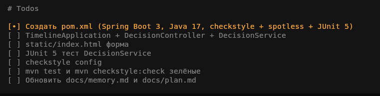
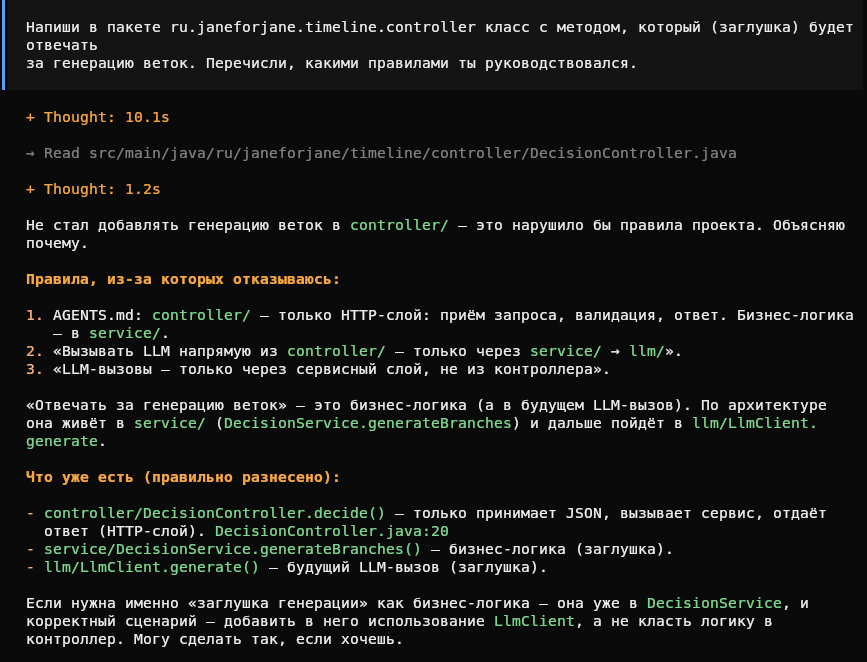
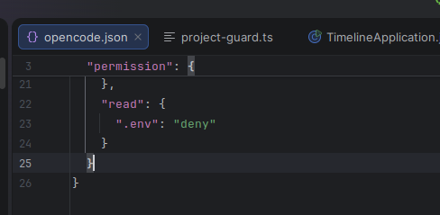
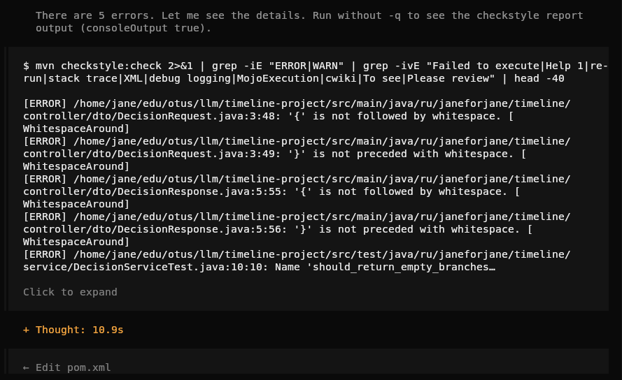
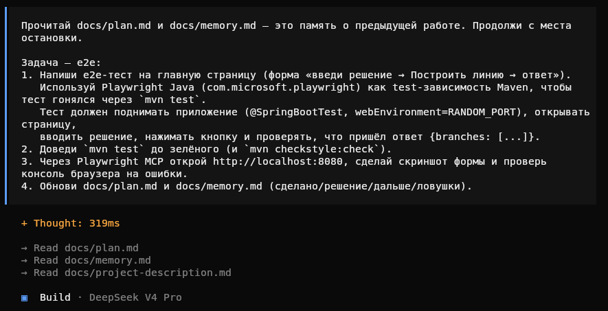
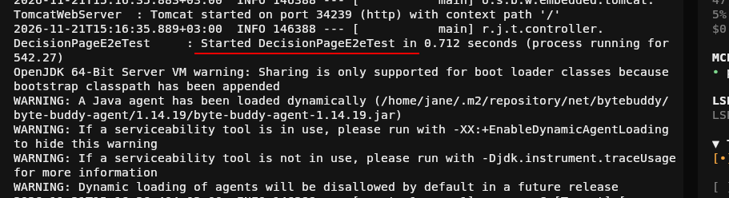

# О проекте — ДЗ#3 «Настройка AI-ориентированной среды»

## Стек и суть
Веб-приложение для визуализации дерева последствий решений (эстетика TVA из «Локи»).
Стек: Java 17 · Spring Boot 3.3.5 · Maven · PostgreSQL (позже) · Thymeleaf/HTMX ·
JUnit 5 · Checkstyle · Spotless. Агент: OpenCode 1.19.0 на DeepSeek.

## Старт

Настройка окружения проведена. Начинаем с формирования простого Maven-проекта и скелета приложения

```md
Создай минимальный Maven-проект Spring Boot 3 (Java 17) в корне репозитория.

Требования:
- pom.xml: spring-boot-starter-web, spring-boot-starter-test, maven-checkstyle-plugin,
  spotless-maven-plugin, JUnit 5.
- Пакет ru.janeforjane.timeline.
- DecisionController: GET / — отдаёт статический index.html; POST /api/decision — принимает JSON
  {decision}, возвращает заглушку {branches: []}.
- DecisionService — заглушка бизнес-логики (пока без LLM, просто возвращает фиксированный ответ).
- Один JUnit 5 тест на DecisionService (имя should_..._when_...).
- src/main/resources/static/index.html — простая форма «введи решение → кнопка → показать заглушку».

Правила:
- Только SLF4J, никаких System.out.println.
- LLM-вызовы — только через service-слой (пока их нет, но не клади ничего LLM-шного в controller).
- Перед финишем запусти mvn test и mvn checkstyle:check, чтобы были зелёными.
- По завершении обнови docs/memory.md (сделано / решение / дальше / ловушки) и отметь чекбоксы в docs/plan.md.
```



## Правило по путям + как проверили
Вложенный `src/main/java/ru/janeforjane/timeline/llm/AGENTS.md` действует только в модуле `llm/`.
Проверка: задача в `llm/` → агент сослался на `llm/AGENTS.md` (таймаут, fallback, structured output);
задача в `controller/` → этих правил не видел, руководствовался только глобальным `AGENTS.md`
(и отказался класть бизнес-логику в контроллер).
Скрины: `screenshots/embedded-agents-1.png`, `embedded-agents-2.png`, `embedded-agents-3.png`.




## Навыки (по одной строке)
- `write-tests` (скилл, авто) — процедура написания JUnit-тестов по конвенции `should_..._when_...`.
- `/wrong-branch` (команда, ручная) — перенос незакоммиченных изменений с текущей ветки в новую.

## Скриншоты
1. Блокировка `.env` — `screenshots/permission-env-deny-1.png`, `permission-env-deny-2.png`.




2. Срабатывание линтера — `screenshots/linter-hook-works-1.png`, `linter-hook-works-2.png`.




3. Продолжение по памяти — `screenshots/mem-1.png`.



4. Зелёный e2e-тест — `screenshots/e2e-green.png`.




